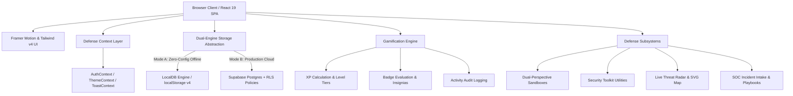

<div align="center">

# 🛡️ CyberGuard
### *Next-Generation Cybersecurity Awareness, Simulation & Defense Portal*

**Transforming Human Vulnerabilities into a Hardened First Line of Cyber Defense.**

[](https://react.dev/)
[](https://www.typescriptlang.org/)
[](https://vitejs.dev/)
[](https://tailwindcss.com/)
[](https://supabase.com/)
[](https://github.com/)
[](LICENSE)

<br />

[⚡ Quick Start](#-quick-start-30-seconds) • [🌟 What Makes CyberGuard Different?](#-what-makes-cyberguard-different) • [🎯 Benefits & Impact](#-benefits--value-proposition) • [🧩 Feature Deep-Dive](#-comprehensive-feature-tour) • [🏗️ Architecture](#️-technical-architecture) • [🚀 Setup Guide](#-setup--deployment)

</div>

---

## 📌 Executive Summary

Over **90% of all organizational security breaches** originate not from unpatched firewall zero-days, but from **social engineering, deceptive phishing links, credential reuse, and human manipulation**. 

Traditional annual corporate slideshows fail because passive compliance videos do not build reflex memory. **CyberGuard** revolutionizes digital defense education by putting users inside **hyper-realistic, dual-perspective threat sandboxes**, story-driven attack narratives, an active **Live Threat Radar**, in-browser **Defensive Security Toolkits**, and real-world **SOC Incident Triage**.

Whether used by **university computer science programs**, **enterprise IT security teams**, or **individual privacy-conscious operators**, CyberGuard bridges the human-factor gap with state-of-the-art interactive pedagogies.

---

## 🌟 What Makes CyberGuard Different?

Most cybersecurity training tools provide abstract multi-choice quizzes without tactile context. CyberGuard is engineered around **real-world defensive muscle memory**:

| Feature Vector | Traditional Training (Slide Decks) | CyberGuard Defense Platform |
| :--- | :--- | :--- |
| **Experience Model** | Passive video lectures & bullet points | **Dual-Perspective Interactive Sandboxes** (Simultaneous victim & attacker views) |
| **Story Realism** | Generic corporate placeholders | **Hyper-Relatable Scenarios** (e.g. ₹1,499 café Wi-Fi payment, Friday 4:52 PM payroll lure) |
| **Defense Utilities** | Abstract theory | **5 In-Browser Security Tools** (Live URL Dissector, Passphrase Vault, Wi-Fi Risk Auditor) |
| **Threat Intelligence** | Outdated annual syllabus | **Live Threat Radar** (Real-time SVG attack vector canvas & MITRE ATT&CK mapping) |
| **Emergency Response** | "Contact your IT department" | **Incident Command & National 1930 Helpline** integration with instant containment playbooks |
| **Offline Architecture** | Requires live cloud subscription | **Zero-Config Dual Engine** (Runs 100% offline via LocalDB or connects to Supabase Postgres) |
| **User Interface** | Clunky corporate portals | **Apple macOS Glassmorphism** (Subtle micro-animations, radial telemetry, dark/light themes) |

---

## 🎯 Benefits & Value Proposition

### 🎓 For Students & Learners
- **Tactile Learning**: Gain deep technical intuition into how attackers manipulate headers, intercept network packets, and harvest credentials.
- **Portfolio-Ready Credentials**: Earn cryptographically logged **Cybersecurity Awareness Certificates** with unique verification IDs and index scores.
- **Gamified Mastery**: Level up from *Tier 1 Cyber Recruit* to *Tier 5 Cyber Sentinel* across 12 distinct achievement insignias.

### 🏢 For Teams & Organizations
- **Drastically Lower Phishing Click Rates**: Employees learn to spot lookalike subdomains (`account-reauth.shop`), spoofed senders, and macro droppers before clicking.
- **Incident Response Muscle Memory**: Staff learn exact containment protocols (air-gapping machines, avoiding RAM key reboots, stopping wire transfers).
- **Zero Ongoing Infrastructure Cost**: Deploy as a serverless static application on Vercel/Netlify backed by Supabase with Row Level Security (RLS).

### 🛡️ For Everyday Citizens
- **Protection Against Real Scams**: Relatable defense against **Digital Arrest** police extortion calls, electricity bill disconnection APKs, and fake delivery fees.
- **The Golden Hour Rule**: Clear instructions on how dialing **1930** within 2–3 hours triggers instant bank account freezes under national financial fraud protocols.

---

## ⚡ Quick Start (30 Seconds)

CyberGuard includes a **self-contained zero-configuration local database engine** (`localDb.ts`). You can run and explore the entire platform without creating any external database accounts!

```bash
# 1. Clone the repository
git clone https://github.com/your-username/cyberguard.git
cd cyberguard

# 2. Install dependencies
npm install

# 3. Start the development server
npm run dev
```

Open your browser at **`http://localhost:5174/`**. Everything works immediately out of the box!

---

## 🧩 Comprehensive Feature Tour

### 1. 🎮 Dual-Perspective Interactive Threat Sandboxes (`/simulations`)
Step into safe virtual attack drills where mistakes carry zero operational risk:

* **Spear-Phishing & Cloned Portal Lab** (`/simulations/phishing-email`):  
  Inspect suspicious Microsoft 365 password expiration notices. Examine weaponized headers, reveal the hidden reverse-proxy redirect, and watch how automated adversary bots log keystrokes in real time.
* **Live Rogue Wi-Fi & MITM Payment Interception** (`/simulations/mitm-attack`):  
  Connect to a simulated coffee shop network (`Cafe_Free_WiFi`). Watch live packet eavesdropping as an unencrypted transaction for ₹1,499 is intercepted and modified to ₹9,499. Learn how VPN tunneling renders intercepted data useless.
* **Double-Click Ransomware & Containment Drill** (`/simulations/ransomware-response`):  
  Watch an endpoint get hijacked by a disguised `.pdf.exe` payload. Experience real-time file extension corruption (`.DARKVAULT_LOCKED`), dark-web ransom countdowns, and practice immediate network air-gapping.
* **Mobile Bank Smishing & Fake Cancellation Scam** (`/simulations/social-engineering-call`):  
  Examine an urgent 9:15 PM SMS claiming an unauthorized bank debit. Watch the side-by-side view as attackers harvest credentials and weaponize the "Cancellation OTP" trick.

---

### 2. 🎓 Comprehensive Training Academy (`/training`)
A structured 6-module curriculum featuring **18 story-driven lessons**:
* **Module 1: Cybersecurity Fundamentals** (CIA Triad, Threat Actor Profiles, The Human Perimeter)
* **Module 2: Password & Account Security** (Entropy Mechanics, Password Managers, FIDO2 & Multi-Factor Auth)
* **Module 3: Phishing & Spear-Phishing Awareness** (Anatomy of Lures, Domain Typosquatting, Weaponized Attachments)
* **Module 4: Social Engineering & Pretexting** (Executive Impersonation, Digital Arrest Extortion, Deepfake Voice Cloning)
* **Module 5: Malware & Ransomware Defense** (Infection Vectors, Lateral Movement, The 3-2-1 Air-Gapped Backup Rule)
* **Module 6: Network Security & Safe Browsing** (Public Wi-Fi Risks, SSL/TLS Encryption, DNS Spoofing & VPN Shields)

> **Rich Pedagogical Blocks**: Every lesson contains **Interactive Concept Checks** (with confetti celebrations), **Real-World Breach Case Studies** (MGM Resorts, Colonial Pipeline, Uber, Emotet), **Terminal Command Demonstrations**, and **Defense Takeaway Checklists**.

---

### 3. 🧰 Tactical Defensive Security Toolkit (`/tools`)
Five client-side defensive utilities designed for everyday operational hygiene:

1. **Password Health & Passphrase Vault Engine**:  
   Calculates mathematical entropy bits, tests against top leaked dictionary breach tables, estimates crack times across an 8x RTX 4090 GPU cluster rig, and generates memorable 4-word cryptographic passphrases.
2. **Live URL & Domain Phishing Dissector**:  
   Deep lexical parser identifying lookalike subdomains (e.g. `login.microsoft.com.account-update.ru`), unencrypted HTTP endpoints, credential-harvesting keywords, and executable downloads (`.exe`, `.apk`). Includes 3 adversary email samples with red flag annotations.
3. **Public Wi-Fi & Network Security Auditor**:  
   Calculates interception exposure based on encryption (Open, WEP, WPA2, WPA3), physical venue (Airport, Café, Office), SSL certificate handshake warnings, and active VPN tunneling.
4. **Dark Web Data Breach & Credential Exposure Scanner**:  
   Queries simulated threat intelligence databases (Canva, LinkedIn, Adobe, Dropbox) to highlight correlated historical dumps, exposed data classes, and mandatory remediation protocols.
5. **Personal Cyber Hygiene Scorecard**:  
   Interactive 8-point workstation hardening checklist (MFA, password managers, auto-updates, remote wipe, 3-2-1 backups, untrusted Wi-Fi VPN) with persistent progress tracking and defense XP rewards.

---

### 4. 📡 Live Threat Radar & Tactical Intelligence (`/threats`)
Real-time situational awareness inspired by enterprise SOC consoles:
* **Interactive SVG World Projection**: Animated laser attack trajectories linking global sensor hubs (Silicon Valley, Frankfurt, London, Bengaluru, Singapore, Tokyo).
* **Live Intercept Telemetry Stream**: Automated feed logging in-flight ransomware beaconing, credential stuffing spikes, and mobile smishing campaigns with pause/resume controls.
* **DEFCON Cyber Readiness Posture**: Current global threat status indicators tracking active zero-days and emerging exploits.
* **Curated 2025–2026 Bulletins**: 10 real-world advisories with **MITRE ATT&CK Framework Mapping** (Tactics & Techniques) and an instant **"Export IOC Block"** for IP addresses, C2 domains, and SHA-256 hashes.

---

### 5. 🚨 Incident Intake & Automated SOC Triage Station (`/report`)
Empowers users to report suspicious events and immediately receive actionable containment guidance:
* **National Helpline 1930 & Golden Hour Callout**: Real-world emergency guidance for stopping unauthorized financial fraud before funds leave banking networks.
* **1-Click Realistic Lure Presets**: Instant loading for *CEO Urgent Wire Requests*, *Digital Arrest Video Extortion*, *Electricity Bill Smishing*, and *LockBit Ransomware File Locks*.
* **Dynamic Attack Questionnaires**: Vector-specific questions assessing credential entry, APK installations, and file modifications.
* **Automated Containment Playbooks**: Generates official incident dispatch tickets (`INC-2026-XXXXX`), risk scoring, automated perimeter firewall quarantine actions, and step-by-step containment instructions (+30 Defense XP).

---

### 6. 🏆 Rankings, Badges & Tiers Hierarchy (`/leaderboard`)
* **Podium of Champions**: Top 3 cyber defense operators rendered with 3D medal styling (🥇 Gold, 🥈 Silver, 🥉 Bronze).
* **Personal Standing Card**: Highlights current rank, tier status, and the exact XP gap needed to overtake the next operator.
* **12 Achievement Insignias**: Badges with rarity ratings (*Common, Rare, Epic, Legendary*) tracking milestones across phishing defense, ransomware containment, threat intelligence, and hygiene audits.
* **5-Tier Operator Progression Roadmap**: Visual career ladder from *Tier 1 Cyber Recruit* to *Tier 5 Cyber Sentinel* with unlockable tooling privileges.

---

### 7. 🎯 Diagnostic Assessment & Verified Credentialing (`/assessment` & `/certificate`)
* **Comprehensive 12-Question Diagnostic**: Covers all 6 core attack surfaces with randomized question sequences and an interactive navigation ribbon.
* **Domain-by-Domain Readiness Matrix**: Detailed competency grading across Fundamentals, Passwords, Phishing, Social Engineering, Ransomware, and Wi-Fi.
* **Accredited Digital Certificate**: Operators scoring **61%+** unlock a printable, verified **Cybersecurity Awareness Certificate** with unique Credential IDs.

---

## 🏗️ Technical Architecture

CyberGuard is built using a modern, reactive single-page architecture with a dual-persistence abstraction layer:



### 💻 Technology Stack

| Layer | Technology | Rationale |
| :--- | :--- | :--- |
| **Frontend Core** | React 19 + TypeScript | High performance, strict type safety, zero runtime prop mismatches |
| **Build & Bundler** | Vite 8 + ESBuild | Instant Hot Module Replacement (HMR) and sub-500ms production builds |
| **Styling & Design** | Tailwind CSS v4 | Clean utility classes, Apple macOS dark/light glassmorphism |
| **Animations** | Framer Motion | Fluid physics-based transitions, micro-interactions, modal drawers |
| **Icons & Typography** | Tabler Icons + Space Grotesk / Inter | Curated developer aesthetics with crisp vector glyphs |
| **Cloud Backend** | Supabase (PostgreSQL 15) | Row Level Security (RLS), JWT authentication, automated triggers |
| **Offline Engine** | `localDb.ts` In-Memory Adapter | 100% offline functionality without requiring Docker or cloud accounts |

---

## 📁 Repository Structure

```text
cyberguard/
├── public/                     # Static assets, SVG logos, and icons
├── src/
│   ├── components/
│   │   ├── layout/             # Public navbar, dashboard shell, route guards
│   │   ├── simulations/        # Interactive sandboxes (Phishing, Ransomware, Mitm, Smishing)
│   │   └── ui/                 # Primitives (MacOsWindow, Buttons, Cards, Pills, ProgressBars)
│   ├── context/                # AuthContext, ThemeContext, ToastContext
│   ├── hooks/                  # useContent.ts (Data hooks for modules, quizzes, leaderboards)
│   ├── lib/
│   │   ├── localDb.ts          # Offline local database engine with pre-seeded curriculum
│   │   ├── supabase.ts         # Supabase client connector
│   │   ├── gamification.ts     # XP calculation, level evaluation, badge unlocking
│   │   ├── celebrate.ts        # Canvas confetti celebration engine
│   │   └── utils.ts            # ClassNames merger (clsx + tailwind-merge)
│   ├── pages/
│   │   ├── UserDashboardPage.tsx       # Defense Center dashboard with 5-vector matrix
│   │   ├── TrainingPage.tsx            # Training Academy syllabus
│   │   ├── ModuleDetailPage.tsx        # Story-driven lessons & interactive checks
│   │   ├── SimulationsPage.tsx         # Sandbox catalog
│   │   ├── SimulationPlayerPage.tsx    # Live simulation orchestrator
│   │   ├── SecurityToolsPage.tsx       # 5-tool security utility suite
│   │   ├── ThreatIntelligencePage.tsx  # Live Threat Radar & SVG attack canvas
│   │   ├── AssessmentPage.tsx          # 12-question readiness diagnostic
│   │   ├── ReportIncidentPage.tsx      # Incident intake & SOC containment playbooks
│   │   ├── LeaderboardPage.tsx         # Rankings, Badges & Tiers Command
│   │   ├── CertificatePage.tsx         # Printable verified credential
│   │   ├── SettingsPage.tsx            # System preferences & telemetry export
│   │   └── admin/                      # Admin CRUD portals for courses, quizzes, reports
│   ├── types/                  # TypeScript interfaces for modules, lessons, simulations
│   ├── App.tsx                 # Route declarations & layout wrappers
│   └── main.tsx                # Application bootstrap
├── supabase/
│   ├── schema.sql              # PostgreSQL DDL schema with RLS security policies
│   └── seed.sql                # Production starter seed dataset
├── package.json                # Project dependencies & scripts
└── vite.config.ts              # Vite configuration (Port 5174)
```

---

## 🚀 Setup & Deployment

### Mode 1: Offline Local Mode (Default)
No setup required! Clone, run `npm install`, then `npm run dev`. The in-browser database engine (`localDb.ts`) automatically manages state, profiles, scores, and lessons inside `localStorage`.

### Mode 2: Supabase Cloud Database Mode (Optional)
To connect CyberGuard to a dedicated Supabase PostgreSQL cloud instance:

1. Create a free project at [supabase.com](https://supabase.com/).
2. In your Supabase project dashboard, navigate to the **SQL Editor**.
3. Copy and run the contents of [`supabase/schema.sql`](supabase/schema.sql).
4. Copy and run the contents of [`supabase/seed.sql`](supabase/seed.sql).
5. Create a `.env` file in the root of this project:
   ```env
   VITE_SUPABASE_URL=https://your-project-id.supabase.co
   VITE_SUPABASE_ANON_KEY=your-anon-public-key
   ```
6. Run `npm run dev`. CyberGuard will now authenticate and synchronize with your live cloud database!

---

## 👑 Accessing the Admin Management Console

CyberGuard includes a comprehensive administrative portal (`/admin`) for adding modules, updating quizzes, reviewing telemetry, and managing user roles:

1. Register an account within the app.
2. In your Supabase dashboard (or `localDb.ts`), locate your user record in the `profiles` table.
3. Change your `role` column from `"user"` to `"admin"`.
4. Log in. CyberGuard will automatically display the **Admin Console** in your navigation!

---

## 🛠️ Build & Verification Scripts

| Script | Description |
| :--- | :--- |
| `npm run dev` | Boots local development server on port **5174** with instant HMR |
| `npm run build` | Compiles TypeScript (`tsc -b`) and bundles for production via Vite |
| `npm run preview` | Previews the optimized production bundle locally |
| `npm run lint` | Runs fast code quality and static analysis checks |

---

## 🔒 Security & Ethical Disclaimer

> [!IMPORTANT]
> **Educational & Defensive Purpose Only**: CyberGuard simulations (phishing lures, ransomware screens, Wi-Fi interceptions, and smishing portals) are executed within **sandboxed, simulated client-side environments**. They do not execute malicious binary code, infect operating systems, or intercept real network traffic.  
> The purpose of this project is strictly defensive: to educate operators on how to identify, neutralize, and report malicious campaigns.

---

## 📄 License

This project is licensed under the **MIT License**. Feel free to use, modify, and deploy this portal for academic institutions, corporate security training, or non-profit awareness initiatives.

<div align="center">
  <sub>Engineered with precision for modern cyber defense. Stay vigilant. Protect the perimeter.</sub>
</div>
