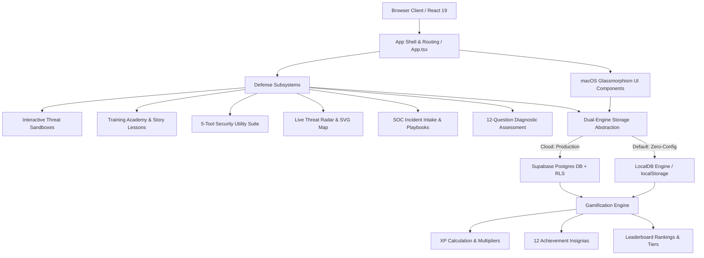

<div align="center">

```
 ██████╗██╗   ██╗██████╗ ███████╗██████╗  ██████╗ ██╗   ██╗ █████╗ ██████╗ ██████╗ 
██╔════╝╚██╗ ██╔╝██╔══██╗██╔════╝██╔══██╗██╔════╝ ██║   ██║██╔══██╗██╔══██╗██╔══██╗
██║      ╚████╔╝ ██████╔╝█████╗  ██████╔╝██║  ███╗██║   ██║███████║██████╔╝██║  ██║
██║       ╚██╔╝  ██╔══██╗██╔══╝  ██╔══██╗██║   ██║██║   ██║██╔══██║██╔══██╗██║  ██║
╚██████╗   ██║   ██████╔╝███████╗██║  ██║╚██████╔╝╚██████╔╝██║  ██║██║  ██║██████╔╝
 ╚═════╝   ╚═╝   ╚═════╝ ╚══════╝╚═╝  ╚═╝ ╚═════╝  ╚═════╝ ╚═╝  ╚═╝╚═╝  ╚═╝╚═════╝ 
```

### *Next-Generation Cybersecurity Awareness, Simulation & Incident Defense Portal*

**Transforming Human Vulnerabilities into a Hardened First Line of Cyber Defense.**

<br />

[](https://react.dev/)
[](https://www.typescriptlang.org/)
[](https://vitejs.dev/)
[](https://tailwindcss.com/)
[](https://supabase.com/)
[](https://attack.mitre.org/)
[](https://github.com/)
[](LICENSE)

<br />

[⚡ 30-Second Quick Start](#-30-second-quick-start) • [🌟 What Makes CyberGuard Radically Different?](#-what-makes-cyberguard-radically-different) • [🎯 Benefits & Impact](#-benefits--value-proposition) • [🧩 Feature Deep-Dive](#-comprehensive-feature-tour) • [🏗️ Technical Architecture](#️-technical-architecture) • [🚀 Setup & Cloud Deployment](#-setup--cloud-deployment)

</div>

---

## 📌 Executive Summary

Over **91% of all successful cyberattacks and data breaches** originate not from unpatched software zero-days, but from **social engineering, deceptive phishing links, unencrypted public Wi-Fi interception, credential reuse, and psychological manipulation**.

Traditional corporate training programs fail because **passive annual slideshows and static compliance videos do not build reflex memory**. When an employee receives an urgent payment lure or a citizen faces a "Digital Arrest" extortion call, abstract bullet points vanish under pressure.

**CyberGuard** reinvents human cyber defense through **tactile, experiential learning**. Instead of reading about attacks, users enter **hyper-realistic dual-perspective threat sandboxes** (seeing both victim and adversary viewpoints simultaneously), conduct live investigations with **client-side security toolkits**, track global adversary telemetry on an interactive **Live Threat Radar**, and execute emergency response procedures via an integrated **Automated SOC Incident Triage Station**.

Whether deployed as an **academic minor/major project**, an **enterprise security onboarding curriculum**, or a **community public awareness initiative**, CyberGuard bridges the critical human-factor gap with state-of-the-art web technology.

---

## 🌟 What Makes CyberGuard Radically Different?

Most educational cybersecurity websites offer generic multiple-choice quizzes with textbook definitions. CyberGuard was engineered from the ground up with **7 foundational innovations** that set it apart from conventional security portals:

| Dimension | Traditional Training Portals / LMS | 🛡️ CyberGuard Defense Platform |
| :--- | :--- | :--- |
| **Experience Architecture** | Passive video streams & 2D slideshows | **Dual-Perspective Interactive Sandboxes** (Simultaneous victim & attacker console views) |
| **Scenario Realism** | Abstract corporate placeholders ("Company X") | **Hyper-Relatable Storylines** (The ₹1,499 Café Wi-Fi, 4:52 PM Payroll Lure, Digital Arrest) |
| **Tactical Utilities** | Theoretical advice ("Use strong passwords") | **5 Client-Side Defensive Tools** (Entropy & GPU crack calculator, URL dissector, Wi-Fi auditor) |
| **Situational Awareness** | Outdated annual syllabus PDFs | **Live Threat Radar** (Animated SVG vector canvas, live intercept feed, MITRE ATT&CK mapping) |
| **Emergency Response** | Generic "Email your IT Helpdesk" | **SOC Incident Intake & National 1930 Helpline** integration with automated containment tickets |
| **Zero-Barrier Setup** | Requires Docker, paid cloud APIs, or complex setup | **Zero-Config Dual Storage Engine** (Runs 100% offline out-of-the-box via LocalDB or links to Supabase) |
| **Visual Aesthetics** | Clunky, dated enterprise forms | **Apple macOS Glassmorphism** (Subtle micro-animations, radial telemetry, dark/light themes) |

---

### The 7 Core Differentiators in Detail

```
┌─────────────────────────────────────────────────────────────────────────────────────────────────┐
│                                 THE 7 PILLARS OF CYBERGUARD                                    │
└─────────────────────────────────────────────────────────────────────────────────────────────────┘
     │                    │                    │                    │                    │
     ▼                    ▼                    ▼                    ▼                    ▼
[1. Dual-View       [2. Hyper-Real       [3. In-Browser       [4. Live Threat      [5. National SOC
   Sandboxes]           Stories]           Defensive Tools]       Radar & MITRE]       Triage & 1930]
     │                    │                    │                    │                    │
     └──────────────┬─────┴────────────────────┴────────────────────┴─────┬──────────────┘
                    ▼                                                     ▼
           [6. Zero-Config Dual Engine]                         [7. macOS Glassmorphism &
             (100% Offline + Supabase)                             Accredited Credentials]
```

#### 1. 👁️ Dual-Perspective Sandbox Technology
In conventional phishing drills, users click a link and are simply told *"You failed!"*. CyberGuard features a synchronized **split-screen sandbox**. As you examine a weaponized Microsoft 365 lure or a banking SMS, an adjacent **Adversary Telemetry Terminal** demonstrates exactly how reverse-proxy bots capture session tokens, record keystrokes, and bypass 2FA in real time. Seeing what the adversary sees permanently eliminates curiosity-driven unsafe clicks.

#### 2. 📖 Hyper-Relatable, Story-Driven Attack Narratives
Rather than sterile corporate hypotheticals, scenarios are grounded in real-world psychology:
- **The ₹1,499 Café Wi-Fi Scam**: An unencrypted payment at a coffee shop where an attacker performs ARP spoofing to alter the transaction payload to ₹9,499.
- **The Digital Arrest & Video Extortion Call**: Impersonation of cybercrime police officers issuing fake supreme court warrants over video.
- **The 4:52 PM Friday Payroll Lure**: Time-pressured executive impersonation requesting urgent banking detail re-validation before payroll processing cut-off.
- **The Electricity Bill APK Trap**: Urgent disconnection notices baiting users into installing remote-access trojans (`.apk`).

#### 3. 🧰 Five Client-Side Defensive Security Tools
CyberGuard provides hands-on diagnostic utilities directly in the browser:
- **Passphrase Entropy & GPU Crack Estimator**: Computes mathematical Shannon entropy and estimates cracking durations against an 8x NVIDIA RTX 4090 GPU cluster.
- **Live URL & Subdomain Dissector**: Analyzes raw URLs for Punycode homographs, lookalike subdomains, suspicious TLDs, and executable extensions.
- **Public Wi-Fi Risk Auditor**: Calculates venue-based interception exposure based on cipher suites (Open, WEP, WPA2, WPA3), captive portals, and SSL handshakes.
- **Dark Web Breach Exposure Scanner**: Cross-references simulated intelligence dumps (Canva, Adobe, LinkedIn) to display compromised data classes and remediation checklists.
- **Personal Cyber Hygiene Hardening Matrix**: An 8-point workstation hardening audit with defense XP rewards.

#### 4. 📡 Live Threat Radar with MITRE ATT&CK Mapping
Operators monitor active global cyber activity via an animated SVG world map connecting global telemetry nodes (Silicon Valley, Frankfurt, London, Bengaluru, Singapore, Tokyo). Real-time intercept feeds stream in-flight ransomware beaconing and credential stuffing surges. Threat bulletins provide full mapping to **MITRE ATT&CK Tactics & Techniques** with a 1-click **Export IOC Block** (IP addresses, C2 domains, SHA-256 hashes).

#### 5. 🚨 Real-World SOC Incident Intake & "Golden Hour" Protocol
CyberGuard bridges awareness with incident command. Operators practice reporting incidents with 1-click presets (CEO Wire Fraud, LockBit File Lock, APK Smishing). The system generates official dispatch tickets (`INC-2026-XXXXX`), calculates risk vectors, provides instant containment playbooks (quarantine commands, network isolation steps), and features direct callouts for the **National Cyber Crime Reporting Helpline (1930)** to freeze illicit wire transfers within the critical 2–3 hour window.

#### 6. ⚡ Zero-Config Dual-Engine Architecture
You can download, build, and run the entire platform **without configuring a single database or cloud account**. The built-in `localDb.ts` engine provides a complete in-browser relational model with pre-seeded modules, lessons, quizzes, operator leaderboards, and badges using `localStorage`. When ready for multi-user production, simply drop in Supabase credentials—the application automatically transitions to cloud PostgreSQL with Row Level Security (RLS).

#### 7. 🎨 Apple macOS Glassmorphism & Accredited Digital Credentials
Designed like a state-of-the-art defense command console rather than a generic LMS. Features dark/light themes, subtle frosted-glass backdrops, physics-driven Framer Motion micro-interactions, 3D champion podiums, 12 achievement insignias across 4 rarity tiers, and an **Accredited Digital Certificate** with cryptographically structured credential IDs (`CG-2026-XXXXX`) generated upon passing the comprehensive 12-question diagnostic assessment.

---

## 🎯 Benefits & Value Proposition

### 🎓 For Students, Colleges & Academic Institutions
* **Capstone Minor/Major Project Standard**: Built to demonstrate advanced software engineering practices: strict TypeScript type safety, modular component architecture, reactive state management, and modern CSS.
* **Resume & Portfolio Ready**: Students learn real defensive security concepts (CIA Triad, MITRE ATT&CK, FIDO2 WebAuthn, Shannon Entropy, ARP Spoofing) with a demonstrable interactive platform.
* **Earn Verified Credentials**: Passing the comprehensive assessment generates a downloadable, printable credential with a verifiable verification index score.

### 🏢 For Enterprises & IT Security Teams
* **Measurable Phishing Reduction**: Interactive dual-perspective sandboxes produce higher retention and behavioral change compared to passive annual compliance slideshows.
* **Automated Incident Response Drills**: Trains employees on the crucial first 5 minutes of an incident—disconnecting from networks, avoiding destructive reboots, preserving evidence, and reporting early.
* **Zero Infrastructure Overhead**: Runs as a lightweight static web app on Vercel, Netlify, or Cloudflare Pages with zero server maintenance costs.

### 🛡️ For Everyday Citizens & Non-Technical Users
* **Protection Against Prevalent Scams**: Demystifies UPI payment fraud, digital arrest extortion scams, fake electricity bill disconnection messages, and remote screen-sharing traps.
* **Actionable Emergency Guidance**: Educates users on the **National Helpline 1930** and the critical "Golden Hour" financial freeze protocol before stolen funds exit banking systems.

---

## ⚡ 30-Second Quick Start

CyberGuard is configured to run immediately with zero external dependencies using the integrated **LocalDB Engine**:

```bash
# 1. Clone the repository
git clone https://github.com/your-username/cyberguard.git
cd cyberguard

# 2. Install dependencies
npm install

# 3. Start the local development server
npm run dev
```

Open your browser and navigate to **`http://localhost:5174/`**. 

> [!TIP]
> **Zero Configuration Required**: All modules, interactive lessons, sandboxes, tools, leaderboards, and assessment quizzes are pre-seeded and ready to use immediately!

---

## 🧩 Comprehensive Feature Tour

### 1. 🎮 Dual-Perspective Interactive Threat Sandboxes (`/simulations`)

Experience realistic simulated attacks inside a zero-risk virtual containment environment:

| Simulation Lab | Attack Vector | Victim Perspective | Adversary Telemetry View | Key Takeaway |
| :--- | :--- | :--- | :--- | :--- |
| **Spear-Phishing & Cloned Portal** | Credential Harvesting | Interactive Microsoft 365 password expiry notice with fake auth prompt | Live terminal capturing POST requests, keystrokes, and session cookies | Always inspect the root domain, not just the prefix subdomain. |
| **Rogue Wi-Fi & MITM Interception** | ARP Spoofing / Packet Sniffing | Café Wi-Fi portal making a simulated ₹1,499 payment | Wireshark-style packet capture altering amount to ₹9,499 in transit | Unencrypted Wi-Fi exposes raw payloads; VPN shields traffic. |
| **Double-Click Ransomware Lab** | Disguised Executable (`.pdf.exe`) | Corporate desktop infected by an urgent resume attachment | File system cipher encryption (`.DARKVAULT_LOCKED`) & countdown clock | Disconnect network cable immediately; never reboot or pay ransom. |
| **Mobile Smishing & Cancellation Scam** | SMS Urgent Bank Pretexting | Smartphone interface with urgent debit warning & cancellation link | Cloud C2 panel harvesting online banking credentials and OTPs | Banks never send cancellation links via SMS or request OTPs over the phone. |

---

### 2. 🎓 Training Academy (`/training`)

A structured 6-module curriculum containing **18 story-driven lessons** engineered for maximum retention:

```
[Module 1: Fundamentals] ──► [Module 2: Passwords & MFA] ──► [Module 3: Phishing & Lures]
                                                                     │
[Module 6: Network & Wi-Fi] ◄── [Module 5: Ransomware Defense] ◄─────┘
                                  & Malware Containment
```

* **Module 1: Cybersecurity Fundamentals**
  * *Lesson 1.1*: The CIA Triad in Everyday Life (Confidentiality, Integrity, Availability)
  * *Lesson 1.2*: Threat Actors & Attack Motives (Script Kiddies to Nation-State APTs)
  * *Lesson 1.3*: The Human Factor: The New Security Perimeter
* **Module 2: Password Security & Authentication**
  * *Lesson 2.1*: Anatomy of a Strong Password & Entropy Mechanics
  * *Lesson 2.2*: Password Managers: Your Digital Security Vault
  * *Lesson 2.3*: Multi-Factor Authentication: Beyond Traditional Passwords (SMS vs TOTP vs FIDO2)
* **Module 3: Phishing, Spear-Phishing & Whaling**
  * *Lesson 3.1*: Anatomy of a Phishing Email: Deconstructing Weaponized Headers
  * *Lesson 3.2*: Spear-Phishing & CEO Fraud: Targeted Social Engineering
  * *Lesson 3.3*: Domain Spoofing, Lookalikes & Weaponized Attachments
* **Module 4: Social Engineering & Psychological Triggers**
  * *Lesson 4.1*: The Psychology of Manipulation: Urgency, Authority & Fear
  * *Lesson 4.2*: Pretexting, Vishing & Digital Arrest Scams
  * *Lesson 4.3*: Deepfakes & AI-Powered Social Engineering Attacks
* **Module 5: Malware, Spyware & Ransomware Defense**
  * *Lesson 5.1*: Malware Types: Trojans, Worms, Keyloggers & Stealers
  * *Lesson 5.2*: Ransomware Anatomy: From Initial Foothold to Domain Encryption
  * *Lesson 5.3*: Incident Containment & The 3-2-1 Air-Gapped Backup Strategy
* **Module 6: Network Security & Safe Browsing**
  * *Lesson 6.1*: The Dangers of Public & Rogue Wi-Fi Networks
  * *Lesson 6.2*: SSL/TLS, HTTPS & DNS Spoofing Explained
  * *Lesson 6.3*: Securing Your Digital Footprint with VPNs & Secure DNS

> **Rich Pedagogical Elements**: Every lesson features **Interactive Concept Check Quizzes** (with confetti feedback), **Real-World Breach Breakdowns** (MGM Resorts, Colonial Pipeline, Uber, Emotet), **Terminal Command Previews**, and **Defense Summary Checklists**.

---

### 3. 🧰 Tactical Defensive Security Toolkit (`/tools`)

A suite of 5 client-side utilities engineered for operational digital hygiene:

```
┌─────────────────────────┬─────────────────────────┬─────────────────────────┐
│   Passphrase Entropy    │    Live URL Dissector   │    Public Wi-Fi Risk    │
│    & GPU Crack Time     │    & Phishing Parser    │     Auditing Engine     │
├─────────────────────────┼─────────────────────────┴─────────────────────────┤
│   Dark Web Credential   │         Personal Workstation Cyber Hygiene        │
│    Exposure Scanner     │                 Hardening Matrix                  │
└─────────────────────────┴───────────────────────────────────────────────────┘
```

1. **Password Health & Passphrase Vault**:  
   Calculates mathematical Shannon entropy ($H = L \cdot \log_2(N)$), checks against common breach wordlists, estimates crack times across an 8x NVIDIA RTX 4090 GPU cluster (164 GH/s for NTLM), and generates cryptographically secure 4-word passphrases.
2. **Live URL & Domain Phishing Dissector**:  
   Performs deep lexical parsing of URLs to expose lookalike subdomains (e.g., `login.microsoft.com.account-update.ru`), unencrypted HTTP protocols, credential-harvesting parameters, and hidden file extensions (`.exe`, `.scr`, `.apk`).
3. **Public Wi-Fi & Network Security Auditor**:  
   Analyzes connection risks across venue types (Café, Airport, Hotel, Office), encryption ciphers (Open, WEP, WPA2, WPA3), captive portal redirects, and provides real-time risk scores with VPN recommendations.
4. **Dark Web Breach & Credential Exposure Scanner**:  
   Simulates threat intelligence queries across known historical breach databases (Canva, LinkedIn, Adobe, Dropbox), highlighting compromised data classes (hashes, emails, phone numbers) and immediate mitigation actions.
5. **Personal Cyber Hygiene Hardening Matrix**:  
   An interactive 8-point workstation hardening audit covering MFA, password managers, automated OS updates, remote wipe capabilities, air-gapped backups, and DNS-over-HTTPS.

---

### 4. 📡 Live Threat Radar & Tactical Intelligence (`/threats`)

Enterprise-grade situational awareness directly in your browser:
* **Interactive SVG Attack Vector Canvas**: Animated glowing laser trajectories visualizing simulated cyber skirmishes between major global hubs (Silicon Valley, Frankfurt, London, Bengaluru, Singapore, Tokyo).
* **Live Intercept Telemetry Stream**: Streaming feed logging in-flight ransomware C2 beacons, credential stuffing surges, and SMS phishing campaigns with pause/resume controls.
* **DEFCON Cyber Readiness Posture**: Real-time threat readiness level with indicator rings tracking active threat vectors.
* **Curated Threat Bulletins**: 10 real-world advisories mapped to the **MITRE ATT&CK Framework** (Techniques & Tactics) with a 1-click **Export IOC Block** for defensive firewall imports.

---

### 5. 🚨 SOC Incident Intake & Automated Triage (`/report`)

Empowers operators to report suspicious events and immediately receive step-by-step containment playbooks:
* **National Helpline 1930 & Golden Hour Protocol**: Critical emergency guidance detailing how to freeze fraudulent financial transactions before stolen money leaves the banking network.
* **1-Click Realistic Incident Presets**:
  * *CEO Urgent Wire Fraud*: Payroll diversion lure with spoofed executive email.
  * *Digital Arrest Police Video Extortion*: Video call extortion with fake Supreme Court warrants.
  * *Electricity Bill APK Disconnection*: Urgent SMS with fake bill payment APK.
  * *LockBit Ransomware File Lock*: Disguised invoice attachment encrypting local directories.
* **Automated Containment Dispatch**: Generates unique tracking tickets (`INC-2026-XXXXX`), computes severity scores, logs simulated perimeter firewall quarantines, and awards +30 Defense XP.

---

### 6. 🏆 Rankings, Badges & Tiers Hierarchy (`/leaderboard`)

* **Podium of Champions**: Top 3 cyber defense operators displayed on a 3D medal podium (🥇 Gold, 🥈 Silver, 🥉 Bronze).
* **Operator Standing Card**: Displays your active rank, tier progress, and the exact XP gap required to overtake the next operator.
* **12 Achievement Insignias**: Badges with distinct rarity tiers (*Common, Rare, Epic, Legendary*) covering phishing detection, ransomware containment, threat intelligence, and hygiene audits.
* **5-Tier Operator Progression Roadmap**: Career progression hierarchy from *Tier 1 Cyber Recruit* to *Tier 5 Cyber Sentinel* with unlockable platform privileges.

---

### 7. 🎯 Diagnostic Assessment & Verified Credentialing (`/assessment` & `/certificate`)

* **Comprehensive 12-Question Diagnostic**: Randomized questions spanning all 6 defense categories with an interactive jump-navigation ribbon.
* **Domain Readiness Breakdown**: Evaluates competency across Fundamentals, Passwords, Phishing, Social Engineering, Ransomware, and Wi-Fi.
* **Accredited Digital Certificate**: Operators scoring **61%+** unlock a printable, verifiable certificate featuring official verification IDs (`CG-2026-XXXXX`) and defense index scores.

---

## 🏗️ Technical Architecture

CyberGuard utilizes a modern, reactive single-page architecture with a dual-persistence abstraction layer:

```
                                  ┌─────────────────────────────────┐
                                  │      Browser Client (SPA)       │
                                  │   React 19 + TypeScript + Vite  │
                                  └────────────────┬────────────────┘
                                                   │
                         ┌─────────────────────────┴─────────────────────────┐
                         ▼                                                   ▼
         ┌───────────────────────────────┐                   ┌───────────────────────────────┐
         │     UI & Interaction Layer    │                   │      State & Context Layer    │
         │  Tailwind CSS v4 + Motion     │                   │   AuthContext • ThemeContext  │
         │  Apple macOS Glassmorphism    │                   │   ToastContext • ContentHook  │
         └───────────────┬───────────────┘                   └───────────────┬───────────────┘
                         │                                                   │
                         └─────────────────────────┬─────────────────────────┘
                                                   │
                                  ┌────────────────▼────────────────┐
                                  │    Dual-Persistence Adapter     │
                                  └────────┬────────────────┬───────┘
                                           │                │
                ┌──────────────────────────┘                └──────────────────────────┐
                ▼                                                                      ▼
 ┌───────────────────────────────┐                                      ┌───────────────────────────────┐
 │   Mode A: Offline LocalDB     │                                      │     Mode B: Supabase Cloud    │
 │  In-Browser Relational Store  │                                      │    PostgreSQL 15 + RLS Engine │
 │  Zero-Config • Instant Start  │                                      │  Row-Level Security • Auth    │
 └───────────────────────────────┘                                      └───────────────────────────────┘
```

### Component & Data Flow Architecture



### 💻 Technology Stack & Justification

| Layer | Technology | Version | Purpose & Architectural Rationale |
| :--- | :--- | :--- | :--- |
| **Runtime Core** | [React](https://react.dev/) | `19.2.8` | Latest concurrent features, optimized reconciliation, zero unnecessary re-renders |
| **Language** | [TypeScript](https://www.typescriptlang.org/) | `6.0.2` | Strict end-to-end type safety across modules, simulations, quizzes, and telemetry |
| **Build & Bundler** | [Vite](https://vitejs.dev/) | `8.2.0` | Sub-second cold starts, instant Hot Module Replacement (HMR), optimized tree-shaking |
| **Styling Framework** | [Tailwind CSS](https://tailwindcss.com/) | `4.3.3` | Next-generation engine with native CSS cascade layers and glassmorphism styling |
| **Physics Animations**| [Framer Motion](https://www.framer.com/motion/) | `13.1.1` | Fluid physics-based card transitions, spring-loaded buttons, and modal drawers |
| **Icons** | [Lucide React](https://lucide.dev/) | `1.33.0` | Comprehensive cybersecurity vector glyph set with crisp, uniform visual weight |
| **Celebrations** | [Canvas Confetti](https://www.npmjs.com/package/canvas-confetti) | `1.9.4` | High-performance canvas-based particle bursts for quiz and module completion |
| **Offline Database** | `localDb.ts` In-Memory Adapter | Custom | Self-contained relational database with automatic seeding and zero external dependencies |
| **Cloud Database** | [Supabase (PostgreSQL)](https://supabase.com/) | `2.112.3` | Production relational backend with Row-Level Security (RLS) and JWT auth |

---

## 📁 Detailed Directory Structure

```text
cyberguard/
├── public/                         # Public static assets & favicon
├── src/
│   ├── components/
│   │   ├── layout/
│   │   │   ├── Navbar.tsx          # Public navigation bar with active route indicators
│   │   │   ├── DashboardShell.tsx  # macOS-style sidebar, top command bar, breadcrumbs
│   │   │   └── ProtectedRoute.tsx  # Role-based route guard (User vs Admin)
│   │   ├── simulations/
│   │   │   ├── PhishingEmailSimulation.tsx       # Cloned Microsoft 365 credential harvester
│   │   │   ├── MitmAttackSimulation.tsx          # Rogue Wi-Fi ARP spoofing & packet modifier
│   │   │   ├── RansomwareResponseSimulation.tsx  # File encryption drill with countdown clock
│   │   │   └── SocialEngineeringCallSimulation.tsx # Mobile SMS bank scam with OTP trap
│   │   └── ui/
│   │       ├── MacOsWindow.tsx     # Window container with traffic-light control dots
│   │       ├── Button.tsx          # Reusable button with variants (primary, secondary, danger)
│   │       ├── Card.tsx            # Frosted glass card containers
│   │       ├── Pill.tsx            # Status pills and category badges
│   │       └── ProgressBar.tsx     # Animated progress and readiness indicator bars
│   ├── context/
│   │   ├── AuthContext.tsx         # Unified auth provider (LocalDB + Supabase)
│   │   ├── ThemeContext.tsx        # Dark / Light / System theme state
│   │   └── ToastContext.tsx        # Non-blocking animated toast notifications
│   ├── hooks/
│   │   └── useContent.ts           # Unified data hooks for modules, quizzes, leaderboards
│   ├── lib/
│   │   ├── localDb.ts              # Self-contained offline relational database engine
│   │   ├── supabase.ts             # Supabase client connector
│   │   ├── gamification.ts         # XP calculation, level progression, and badge triggers
│   │   ├── celebrate.ts            # Canvas confetti trigger helper
│   │   └── utils.ts                # Class name merging utility (clsx + twMerge)
│   ├── pages/
│   │   ├── HomePage.tsx            # Hero landing page with live interactive showcase
│   │   ├── LoginPage.tsx           # Authentication page with demo operator credentials
│   │   ├── UserDashboardPage.tsx   # Operator Defense Center with 5-vector matrix
│   │   ├── TrainingPage.tsx        # Training Academy syllabus catalog
│   │   ├── ModuleDetailPage.tsx    # Interactive lessons, concept checks, and case studies
│   │   ├── SimulationsPage.tsx     # Threat Sandbox catalog
│   │   ├── SimulationPlayerPage.tsx# Live simulation orchestrator with slug resolution
│   │   ├── SecurityToolsPage.tsx   # 5-tool tactical defensive security suite
│   │   ├── ThreatIntelligencePage.tsx # Live Threat Radar with SVG world attack canvas
│   │   ├── AssessmentPage.tsx      # 12-question diagnostic assessment exam
│   │   ├── ReportIncidentPage.tsx  # Incident intake & automated SOC triage playbooks
│   │   ├── LeaderboardPage.tsx     # Rankings, Badges & Tiers Command Center
│   │   ├── CertificatePage.tsx     # Printable accredited digital certificate
│   │   ├── ProfilePage.tsx         # User dossier with activity timeline & achievements
│   │   ├── SettingsPage.tsx        # System preferences, notifications & telemetry export
│   │   └── admin/                  # Admin CRUD management portals
│   │       ├── AdminDashboardPage.tsx
│   │       ├── AdminModulesPage.tsx
│   │       ├── AdminLessonsPage.tsx
│   │       ├── AdminQuizzesPage.tsx
│   │       └── AdminIncidentsPage.tsx
│   ├── types/                      # Central TypeScript type definitions
│   │   ├── index.ts
│   │   └── database.ts
│   ├── App.tsx                     # Route definitions & layout wrappers
│   └── main.tsx                    # Application entry point
├── supabase/
│   ├── schema.sql                  # Complete PostgreSQL schema with RLS security policies
│   └── seed.sql                    # Production starter dataset for cloud deployment
├── package.json                    # Project scripts & dependencies
└── vite.config.ts                  # Vite development server configuration
```

---

## 🚀 Setup & Cloud Deployment

### Mode 1: Offline Local Mode (Recommended for Demos & Testing)

CyberGuard runs right out of the box with zero external dependencies:

```bash
# 1. Clone repository
git clone https://github.com/your-username/cyberguard.git
cd cyberguard

# 2. Install dependencies
npm install

# 3. Launch local development server
npm run dev
```

Visit **`http://localhost:5174/`** in your browser. All data persists to your browser's local storage automatically.

---

### Mode 2: Supabase Cloud Mode (Production Multi-User Setup)

To connect CyberGuard to a live PostgreSQL cloud database:

1. Create a free project at [supabase.com](https://supabase.com/).
2. In the Supabase Dashboard, open the **SQL Editor**.
3. Execute the contents of [`supabase/schema.sql`](supabase/schema.sql) to create all 11 tables and Row-Level Security policies.
4. Execute the contents of [`supabase/seed.sql`](supabase/seed.sql) to populate initial modules, quizzes, and simulations.
5. Create a `.env` file in the project root:
   ```env
   VITE_SUPABASE_URL=https://your-project-id.supabase.co
   VITE_SUPABASE_ANON_KEY=your-anon-public-key
   ```
6. Run `npm run dev`. The application will automatically detect your credentials and switch to cloud storage.

---

### Mode 3: 1-Click Production Web Deployment

Deploy CyberGuard to any modern static hosting provider:

#### Deploying on Vercel
```bash
npm install -g vercel
vercel
```

#### Deploying on Netlify
```bash
npm install -g netlify-cli
npm run build
netlify deploy --prod --dir=dist
```

---

## 👑 Accessing the Admin Management Console

CyberGuard includes an administrative console (`/admin`) for adding courses, editing quizzes, monitoring incidents, and managing users:

1. Sign up or log in to an account in the portal.
2. In your browser console (for LocalDB) or Supabase SQL Editor:
   ```sql
   -- For Supabase PostgreSQL:
   UPDATE profiles SET role = 'admin' WHERE email = 'your-email@example.com';
   ```
   *For LocalDB mode*: Open DevTools → Application → Local Storage → `cyberguard_local_db_v4`, locate your profile record in the `profiles` array, and set `"role": "admin"`.
3. Refresh the page. An **"Admin Console"** link will appear in your top navigation and sidebar, granting full CRUD access to courses, lessons, quizzes, and incident tickets.

---

## 🛠️ Verification & Build Commands

| Command | Purpose |
| :--- | :--- |
| `npm run dev` | Starts local dev server at `http://localhost:5174/` with instant HMR |
| `npm run build` | Compiles TypeScript (`tsc -b`) and generates optimized production bundle in `dist/` |
| `npm run preview` | Spins up a local static server to test the production build |
| `npm run lint` | Runs fast code quality and syntax checks via `oxlint` |

---

## 🔒 Security & Ethical Disclaimer

> [!IMPORTANT]
> **Defensive & Educational Use Only**: CyberGuard simulations (phishing email inspectors, ransomware screens, Wi-Fi packet interceptors, and smishing portals) execute entirely within **safe, client-side browser memory**. They do not execute malicious binary payloads, modify local operating system files, or intercept real network traffic.  
> The sole purpose of this platform is **defensive awareness**: training operators to recognize deception, contain compromises, and report incidents through authorized emergency channels.

---

## 📜 MIT License

This project is licensed under the **MIT License**. You are free to use, modify, distribute, and integrate this project for academic institutions, enterprise training programs, or open-source research. See [`LICENSE`](LICENSE) for complete terms.

<div align="center">
  <br />
  <sub>Designed and engineered for modern cyber defense. Stay vigilant. Protect the perimeter.</sub>
  <br /><br />
  <b><a href="#">Back to Top ↑</a></b>
</div>
